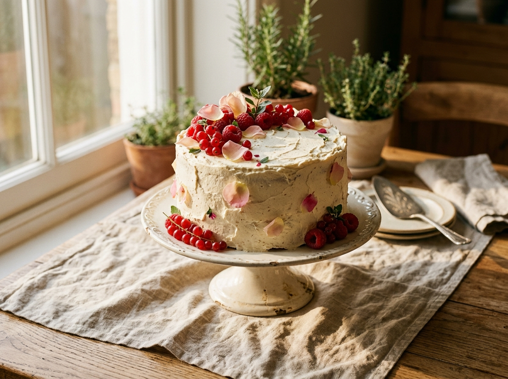

# MAISON CRUMB — Premium Boutique Home Bakery Demo

> **A Website Concept by Veyra Studio**  
> *"Made slowly. Celebrated beautifully."*



A high-end, editorial demo website created by **Veyra Studio** to showcase what a modern, high-converting digital storefront looks like for an Instagram-based home bakery or custom cake studio.

---

## 🎯 The Core Problem & Concept

Many talented home bakers operate exclusively through Instagram DMs, encountering common friction points:
- Customers struggle to find menu offerings, available flavors, and serving sizes across fragmented highlights.
- Bakers spend hours answering repetitive questions about dates, pricing, and dietary options in direct messages.
- Ordering feels informal, leading to ghosted inquiries and lost bookings.

### Primary User Journey
$$\text{Instagram Post/Bio} \longrightarrow \text{Maison Crumb Website} \longrightarrow \text{Visual Discovery} \longrightarrow \text{Date \& Servings Selection} \longrightarrow \text{WhatsApp Order Confirmation}$$

**Conversion Principle**: Instead of a complex, impersonal e-commerce checkout with payment gateways, the entire website funnels customers toward a warm, human, and structured **"ORDER ON WHATSAPP"** conversion point.

---

## ✨ Features & Architecture

### 1. Announcement Bar
- Displays real-time bakery availability: `● Available for Order · Taking limited orders for next week`.
- Discloses the project as a concept by Veyra Studio with a quick reservation link.

### 2. Editorial Sticky Navigation
- Brand lockup: `MAISON CRUMB` with classic French pâtisserie subline.
- Responsive menu with smooth-scroll anchors (`Home`, `Cakes`, `Categories`, `Custom Cakes`, `How It Works`, `Gallery`, `About`).
- Prominent WhatsApp CTA with official SVG iconography.
- Dynamic scroll state: transitions to a compact glassmorphism header when scrolling.
- Fullscreen slide-in mobile drawer for smaller screens.

### 3. Hero Section (Staggered Entrance Animation)
- Headline: *"Made for moments worth remembering."*
- Supporting copy: *"Handcrafted cakes, custom creations and little treats made fresh for your special moments."*
- Dual CTAs: Primary **EXPLORE CAKES** & Secondary **ORDER ON WHATSAPP**.
- Trust highlights: *Freshly Baked Every Morning · Real French Butter & Pure Cocoa · Reserved Oven Slots*.
- Large artisan celebration cake photography with floating metadata card.

### 4. Featured Signature Cakes & Quick-View Modal
- 4 curated product cards:
  - **Classic Chocolate Cake** (From ₹899 · Demo price)
  - **Vanilla Berry Cake** (From ₹949 · Demo price)
  - **Strawberry Cream Cake** (From ₹999 · Demo price)
  - **Chocolate Fudge Cake** (From ₹1,049 · Demo price)
- **Interactive Quick-View Modal**:
  - Displays high-resolution cake imagery, sponge base, filling, portion sizes, and lead times.
  - One-click **"Inquire for this Cake on WhatsApp"** button that pre-populates a targeted WhatsApp message.

### 5. Curated Cake Categories
- Editorial asymmetric grid with hover zoom and upward typography transitions:
  - **Bento Cakes** (Korean 4-inch lunchbox cakes)
  - **Birthday Cakes** (Vintage pearl borders & natural beeswax candle)
  - **Custom Cakes** (Palette-knife sculptural buttercream)
  - **Cupcakes** (Boxed flights of 6 and 12)
  - **Brownies** (Maldon sea salt Belgian dark chocolate)
  - **Celebration Cakes** (Multi-tiered floral centerpieces)
- Clicking any category auto-populates the inquiry form and smoothly scrolls down.

### 6. Custom Cake Atelier Experience
- Section headline: *"Your idea. Our cake."*
- Interactive feature checklist covering theme-based designs, custom flavors, piped inscriptions, and reserved oven slots.
- Dedicated CTA to request custom commissions.

### 7. 4-Step Visual Ordering Journey
1. **01 Choose your cake** — Browse menu or share Instagram mood boards.
2. **02 Tell us requirements** — Flavor, guest count, dietary preferences (eggless available).
3. **03 Confirm your date** — Lock in oven slots via WhatsApp.
4. **04 Pick up or arrange delivery** — Handled car delivery or studio pickup.

### 8. Artisanal Gallery & Lightbox
- Category filter buttons (*All Bakes, Celebration Cakes, Petite Treats, Packaging & Details*).
- Fullscreen lightbox viewer with keyboard navigation and captions.

### 9. Warm About Section (Authentic Storytelling)
- Headline: *"Baked from a little kitchen with a lot of love."*
- Focuses on slow baking, real butter, and fresh seasonal ingredients without fabricating fake awards or statistics.

### 10. Live WhatsApp Order Generator
- Form inputs: *Customer Name, WhatsApp Number, Cake Style, Preferred Date, Servings, Flavor, and Inscription Notes*.
- Automatic date validation: sets the minimum booking date to 2 days ahead for small-batch preparation.
- **Dynamic Live WhatsApp Preview**: Renders a live incoming/outgoing WhatsApp chat bubble simulation on the right, updating in real time as the customer types.
- Clicking **"SEND ENQUIRY VIA WHATSAPP"** formats an organized text payload and launches `wa.me` in a new tab.

### 11. Mobile Sticky Bottom CTA Bar
- Discreet bottom bar for mobile screens with live slot status (`● SLOTS OPEN · Order Next Week's Cake`) and a one-tap WhatsApp button.

---

## 🎨 Design System & Aesthetics

| Token | Value | Purpose |
| :--- | :--- | :--- |
| **`--color-cream-100`** | `#FAF7F2` | Warm porcelain background |
| **`--color-cream-200`** | `#F4EFEA` | Warm linen card surfaces |
| **`--color-cream-300`** | `#EBE3DA` | Subtle dividers and borders |
| **`--color-cocoa-900`** | `#201410` | Deep espresso headings & text |
| **`--color-taupe-600`** | `#685953` | Soft roasted cocoa body text |
| **`--color-terracotta`** | `#BD6B54` | Artisanal warm accent |
| **`--color-rose-accent`** | `#D49B85` | Sub-labels & delicate highlights |
| **`--color-whatsapp`** | `#225C43` | Luxury forest green button |
| **`--font-serif`** | *Cormorant Garamond* | Editorial headings and numbers |
| **`--font-sans`** | *Plus Jakarta Sans* | Navigation, body, buttons, and forms |

- **Reduced Motion**: Full support for `prefers-reduced-motion` media query to ensure accessible navigation.

---

## 📁 Project Structure

```text
d:\website\Cake\
│
├── index.html              # Semantic HTML5 single-page application
├── README.md               # Documentation & setup guide
│
├── css/
│   └── style.css           # Modular Vanilla CSS design system & animations
│
├── js/
│   └── main.js             # Client-side WhatsApp generator, modals, and observers
│
└── assets/
    └── images/             # 13 high-resolution food photography assets
        ├── hero-cake.jpg
        ├── cake-chocolate.jpg
        ├── cake-vanilla-berry.jpg
        ├── cake-strawberry-cream.jpg
        ├── cake-chocolate-fudge.jpg
        ├── cat-bento.jpg
        ├── cat-birthday.jpg
        ├── cat-custom.jpg
        ├── cat-cupcakes.jpg
        ├── cat-brownies.jpg
        ├── cat-celebration.jpg
        ├── about-baker.jpg
        └── gallery-packaging.jpg
```

---

## 🚀 Running Locally

Because this project is built using native web technologies (Vanilla HTML5, CSS3, and ES6 JavaScript), it requires zero build steps or package installations.

### Option 1: Python Built-in Server (Recommended)
From the project root:
```bash
python -m http.server 3000
```
Open your browser and navigate to:
```text
http://localhost:3000
```

### Option 2: Node.js / NPX Serve
```bash
npx serve .
```

### Option 3: Direct File Opening
Double-click `index.html` to open directly in any modern web browser.

---

## 🛠️ Client Customization Guide

When adapting this demo for a real bakery client:

1. **Update WhatsApp Number**:
   - Open [js/main.js](file:///d:/website/Cake/js/main.js)
   - Change `DEMO_WHATSAPP_NUMBER = '919876543210'` to the client's international phone number (without `+` or spaces).
2. **Update Social & Contact Links**:
   - In [index.html](file:///d:/website/Cake/index.html), search for `@maisoncrumb.demo` and replace with the client's actual Instagram handle and email.
3. **Change Products & Flavors**:
   - In [js/main.js](file:///d:/website/Cake/js/main.js), modify the `CAKE_CATALOG` dictionary with the baker's real recipes, portion sizes, prices, and allergen details.
4. **Replace Imagery**:
   - Add the client's real cake photography into `assets/images/`.

---

## ⚖️ Demo & Ethical Disclaimers

- **Brand & Business**: **Maison Crumb** is a fictional boutique brand created solely as a presentation concept.
- **No Fabricated Social Proof**: This demo deliberately does not include fabricated customer reviews, fake awards, counterfeit business statistics, or real customer identities.
- **Concept Attribution**: Designed and developed by **Veyra Studio** (2026).
